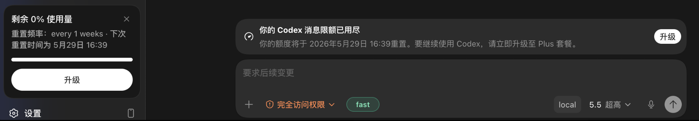

# codex-send-unlock

为 [Codex++](https://github.com/BigPizzaV3/CodexPlusPlus) 提供的用户脚本：隐藏 Codex 消息额度提醒，解除本地聊天的客户端额度发送拦截。

适用于 **官方 ChatGPT 登录 + Magpie 接管请求** 的场景。即使接管后的模型服务仍可用，Codex Desktop 也可能根据原账号额度禁用发送按钮。本脚本让消息继续进入原有发送流程，无需改为 API Key 登录。

## 功能

- 根据额度数据类型阻止消息额度横幅生成，支持“Codex 和工作使用额度已用完”、`You're out of Codex messages` 等文案及其他语言。
- 解除本地聊天的消息额度发送拦截，包括模型专属消息额度；额度轮询和推送更新后仍生效。
- 保留左侧“剩余 0% 使用量”卡片、用量百分比、重置时间和顶栏 Plus 按钮。
- 保护输入框、发送控件和会话正文；正文引用额度提示时不会被隐藏。
- 支持 Codex++ 热重载，禁用或卸载时恢复原始额度缓存和页面。



## 安装

下载 [codex-send-unlock.js](https://raw.githubusercontent.com/zhumengstarsea/codex-send-unlock/main/codex-send-unlock.js)，放入 Codex++ 用户脚本目录：

| 系统 | 路径 |
| --- | --- |
| Windows | `%APPDATA%\Codex++\user_scripts\codex-send-unlock.js` |
| macOS / Linux | `~/.config/Codex++/user_scripts/codex-send-unlock.js` |

在 Codex++ 脚本市场中启用此脚本，点击“热重载脚本”。消息额度横幅应消失，左侧用量卡和顶栏升级按钮应保留。无法热重载时，重启 Codex++ 和 Codex Desktop。

如果之前安装过 `hide-usage-alert.js`，先禁用或移走旧文件，避免两个脚本同时加载。

也可以将下面的指令发给本机 Agent：

```text
请帮我安装 codex-send-unlock 到 Codex++：
1. 根据当前系统找到 Codex++ 用户脚本目录。
   Windows: %APPDATA%\Codex++\user_scripts
   macOS / Linux: ~/.config/Codex++/user_scripts
2. 如有旧版 hide-usage-alert.js，备份并禁用或移走它。
3. 下载 https://raw.githubusercontent.com/zhumengstarsea/codex-send-unlock/main/codex-send-unlock.js
4. 保存为 codex-send-unlock.js，启用此脚本并热重载。
5. 确认运行版本、额度缓存钩子和脚本加载状态。
不要修改 Codex Desktop 安装文件或 Magpie 配置。
```

## 使用边界

本脚本只解除 **renderer 中的消息额度检查**，不会增加官方账号额度、修改登录信息、接管网络请求或改变消息内容。图片生成、代码审查、花费控制、余额和权限限制保持原样。

请先确认 Magpie 等工具已经正确接管请求。官方服务仍会执行服务端限制；本脚本不保证云端任务或 ChatGPT Chat 模式可继续发送。官方支持的额度耗尽后继续使用方式见 [OpenAI 用量说明](https://learn.chatgpt.com/docs/pricing#what-happens-when-you-hit-usage-limits)。

## 诊断

在 Codex renderer 开发者工具中查看：

```js
window.__codexPlusSendUnlock.version
window.__codexPlusSendUnlock.state.sendUnlock
```

`clients` 和 `queries` 应大于 `0`，`error` 应为 `null`。这表示额度缓存钩子已接入，实际回复仍取决于请求接管和模型服务。

手动重新检测可调用 `refreshSendUnlock()`；恢复页面和原始额度缓存可调用 `destroy()`，两者均位于 `window.__codexPlusSendUnlock`。

## 开发与验证

无需安装依赖，使用 Node.js：

```bash
node test.js
node --check codex-send-unlock.js
```

脚本通过 React provider 找到现有 QueryClient，处理主消息额度缓存的 `allowed` / `limit_reached` 状态，并根据 `rate_limit_upsell.banner_type` 过滤消息额度提示，让 React 按正常流程重绘。主路径不匹配文案、语言或 CSS 类名，保留原始用量数据和其他类型的提醒。旧版界面没有结构化提示数据时，使用局部 DOM 文案匹配作为兼容回退；热重载清理通过 Codex++ 的 `registerCleanup` 注册。

已在 Windows Codex `26.1007.2314.0` 的真实 renderer 中验证缓存接入、模拟耗尽更新和热重载恢复。自动测试覆盖提示匹配、输入框保护、缓存更新、卸载恢复和重复注入。实际额度耗尽后的完整发送与回复尚未验证；客户端内部结构变化可能需要更新脚本。

## License

[MIT](LICENSE)。分发时请保留原有版权及许可证声明。
